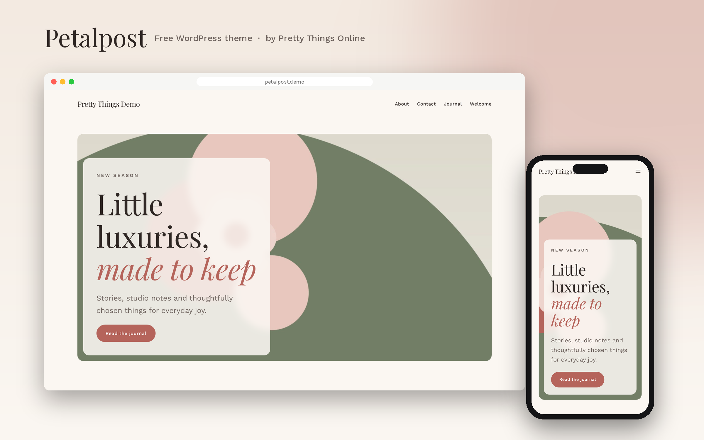
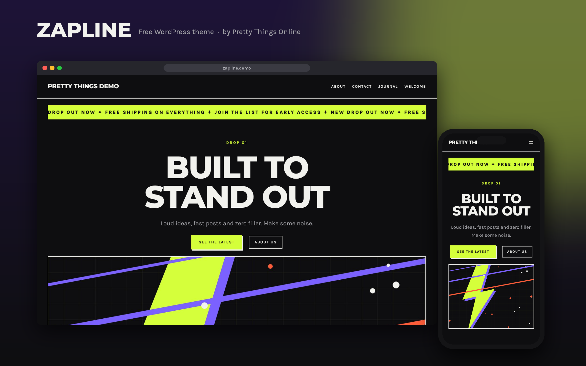
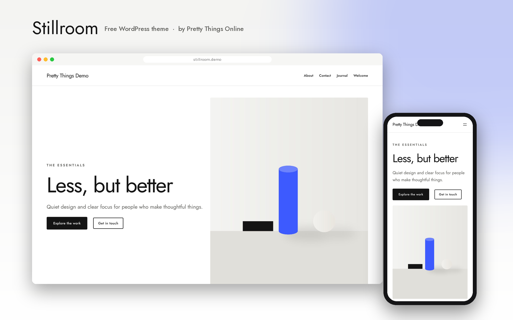

# Free WordPress themes by Pretty Things Online

Three free, modern WordPress **block themes** (full site editing), designed and built by [Pretty Things Online](https://prettythingsonline.com). Free for personal and commercial use under the GPL.

| | Theme | Style | Download |
| --- | --- | --- | --- |
|  | **Petalpost** | Soft boutique: rose and cream, an editorial serif, rounded cards | [petalpost-wordpress-1.0.0.zip](downloads/petalpost-wordpress-1.0.0.zip) |
|  | **Zapline** | Bold and loud: electric lime on black, oversized uppercase type | [zapline-wordpress-1.0.0.zip](downloads/zapline-wordpress-1.0.0.zip) |
|  | **Stillroom** | Clean minimal: split hero, glassy header, lots of white space | [stillroom-wordpress-1.0.0.zip](downloads/stillroom-wordpress-1.0.0.zip) |

## Previews

## What's in every theme

- Block theme for WordPress 6.6 and newer (tested up to 7.1), edited in **Appearance > Editor**
- Three colour styles each, switchable in **Styles**
- Fonts bundled locally (no Google Fonts requests)
- Patterns: hero, three features, image and text, testimonials, newsletter call to action, latest posts grid, full home page and about page
- Templates: blog, home, single post with comments, page, archive, search, 404, plus "Page without title" and "Landing page"
- Custom block styles: Card (group), Eyebrow (paragraph) and Framed (image)
- Accessible focus styles and reduced motion support
- Passes the WordPress Theme Check plugin with no required or recommended issues

## Install

1. Download a zip from the table above.
2. In WordPress go to **Appearance > Themes > Add New Theme > Upload Theme**.
3. Choose the zip, click **Install Now**, then **Activate**.

To build a home page like the preview: create a page, pick the **Landing page** template, insert the "Home page" pattern, then set it as your homepage under **Settings > Reading**.

## Theme credit

Each footer has a small "Designed by Pretty Things Online" link. You can edit or remove it in **Appearance > Editor > Patterns > Footer**, but keeping it is a lovely way to say thanks.

## More free themes

- Shopify: [free-shopify-themes](https://github.com/jameseriksen74/free-shopify-themes)
- Ghost: [free-ghost-themes](https://github.com/jameseriksen74/free-ghost-themes)
- Hugo: [Petalpost](https://github.com/jameseriksen74/hugo-theme-petalpost), [Zapline](https://github.com/jameseriksen74/hugo-theme-zapline), [Stillroom](https://github.com/jameseriksen74/hugo-theme-stillroom)

## License

Themes: GPLv2 or later. Fonts: SIL Open Font License 1.1. Images: original artwork, CC0.
